# Shonan-V2_Lite for RasPI5

Raspberry Pi 5 と ADALM-Pluto(Pluto+)で DVB-S2 DATV を送受信するタッチ画面アプリ(`pi5/`、Python/PyQt5)。
A touch-screen app for DVB-S2 DATV transmit/receive with a Raspberry Pi 5 and an ADALM-Pluto (Pluto+) (`pi5/`, Python/PyQt5).

> [!IMPORTANT]
> **Pluto のユーザー名 `root`・パスワード `analog` は変えないでください。** アプリと Langstone V3 は SSH で Pluto を再起動・設定します。
> **Keep the Pluto user `root` / password `analog`.** The app and Langstone V3 use SSH to reboot and configure the Pluto.

## 主な機能 / Features

- **送信 / TX**: Pluto 内の `pluto_dvb` で DVB-S2 送信。シンボルレート 333〜2000 kS/s、全 28 MOD-COD(QPSK・8PSK・16APSK・32APSK)。
  無印 Pluto(datvplutofrm v0.39-dirty、ソフト変調)と Pluto+(FPGA 版ファーム `plutoplus-udp-fpga-firm`)で同じ操作。
  / DVB-S2 via `pluto_dvb` in the Pluto; 333–2000 kS/s, all 28 MOD-CODs. Same operation on a plain Pluto (v0.39-dirty, software) and a Pluto+ (FPGA firmware).
- **受信 / RX**: Pi 5 上で GNU Radio(gr-dvbs2rx)が復調。APSK は本リポジトリのパッチで対応。 / Demodulated on the Pi 5 with gr-dvbs2rx; APSK via this repository's patch.
- **映像 / Video**: USB カメラ・画像ファイル・テストパターン、H.264/H.265、コールサイン・備考の焼き込み。 / Camera, image or test pattern; H.264/H.265; burned-in callsign/note.
- **その他 / Other**: RSSI 測定、プリセット、機器試験、日本語/英語、日本語キーボード、アプリ内ヘルプ、起動時に Shonan_Lite / Langstone V3 を選択、
  10GHz の LNB 受信、PA/LNA 切替用 PTT 出力(GPIO21)。 / RSSI sweep, presets, diagnostics, JA/EN, on-screen keyboard, help, boot-time app choice, 10 GHz LNB RX, PTT output (GPIO21).

> [!NOTE]
> **16APSK・32APSK は、Pluto のファームの版(IIO の `fw_version`)に大文字の `FPGA` があるときだけ選べます**
> (Pluto+ の FPGA 版、例 `plutoplus-udp-fpga-firm_v1.0-FPGA-26a1`)。大文字・小文字を区別するので、小文字の `fpga` だけでは選べません。
> 版は「設定」→「Pluto 情報」→「バージョン」で確かめられます。
> **16APSK/32APSK can be selected only when the Pluto `fw_version` contains an upper-case `FPGA`** (the Pluto+ FPGA firmware). The check is case-sensitive.
> Check it under Config → Pluto Info → Version.

## 画面 / Screens

実機(7インチ LCD、800x480)、2026-11-12 撮影、Version 2.0.0、Pluto+ FPGA 版ファーム接続、送受信停止中。
撮り方は [`pi5/docs/screen_capture.md`](pi5/docs/screen_capture.md)。操作の詳細はアプリ内ヘルプか
[操作説明書](pi5/docs/shonan_pi5_operation_manual.docx)。
/ Taken on the device (7-inch LCD, 800x480) on 2026-11-12, Version 2.0.0, Pluto+ FPGA firmware, TX/RX stopped.
How they were taken: [`pi5/docs/screen_capture.md`](pi5/docs/screen_capture.md). Details: in-app Help or the [operation manual](pi5/docs/shonan_pi5_operation_manual.docx) (Japanese).

| 画面 / Screen | 説明 / Description |
| --- | --- |
| 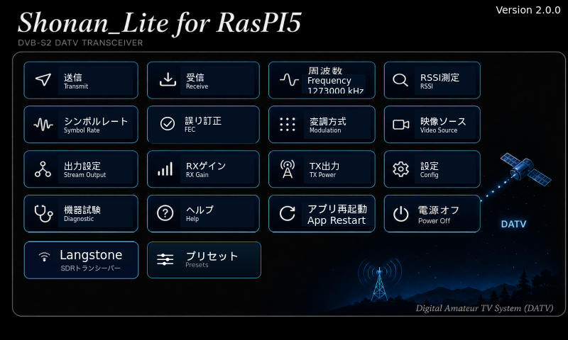 | **Home**<br>各機能のカード。周波数カードに今の周波数を表示。右の衛星をタップすると Langstone V3 を 10GHz 受信用のバンドで開く。<br><br>Cards for every function; the Frequency card shows the current frequency. Tapping the satellite opens Langstone V3 on the 10 GHz receive band. |
| 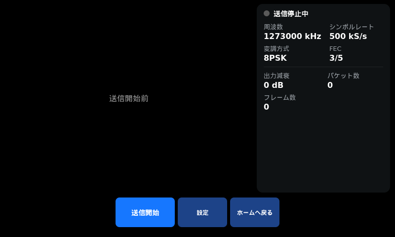 | **送信 / TX**<br>送信映像のプレビューと送信状態(周波数・シンボルレート・変調方式・FEC・出力・パケット数・フレーム数)。「送信開始」で送信する。<br><br>Preview of the transmitted video and TX status (frequency, symbol rate, modulation, FEC, power, packets, frames). "Start TX" transmits. |
| 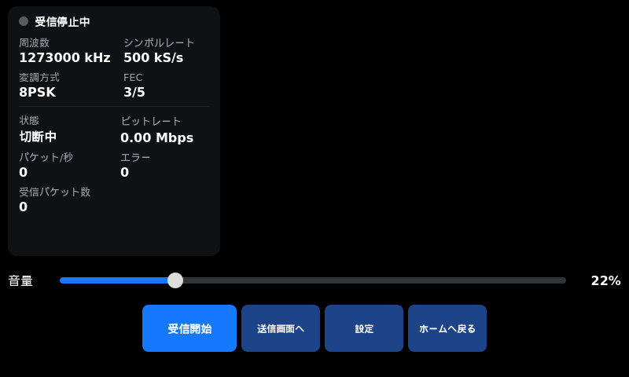 | **受信 / RX**<br>Pi 5 上で復調した受信状態(LOCK・ビットレート・パケット/秒・エラー)と受信映像。音量はスライダーかロータリーエンコーダで変える。<br><br>RX status demodulated on the Pi 5 (LOCK, bit rate, packets/s, errors) and the received video. Volume with the slider or the rotary encoder. |
| 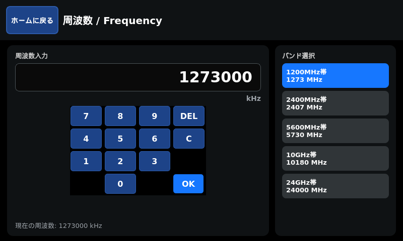 | **周波数 / Frequency**<br>テンキーで kHz 入力、右でバンド(1200MHz〜24GHz)を選ぶ。10GHz帯は LNB を使うか確認する(使うと受信専用)。<br><br>Enter kHz on the keypad or pick a band (1200 MHz to 24 GHz). The 10 GHz band asks whether an LNB is used (then receive only). |
| 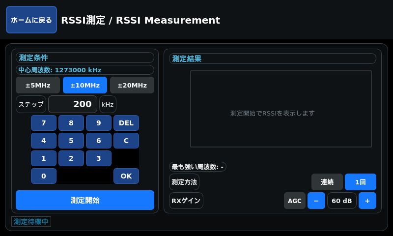 | **RSSI測定 / RSSI**<br>中心周波数の±5/10/20 MHz をステップごとに測り、受信レベルをグラフにして一番強い周波数を示す。1回/連続、RXゲインも選べる。<br><br>Sweeps ±5/10/20 MHz around the centre in steps, graphs the level and shows the strongest frequency. Once/continuous and RX gain selectable. |
| 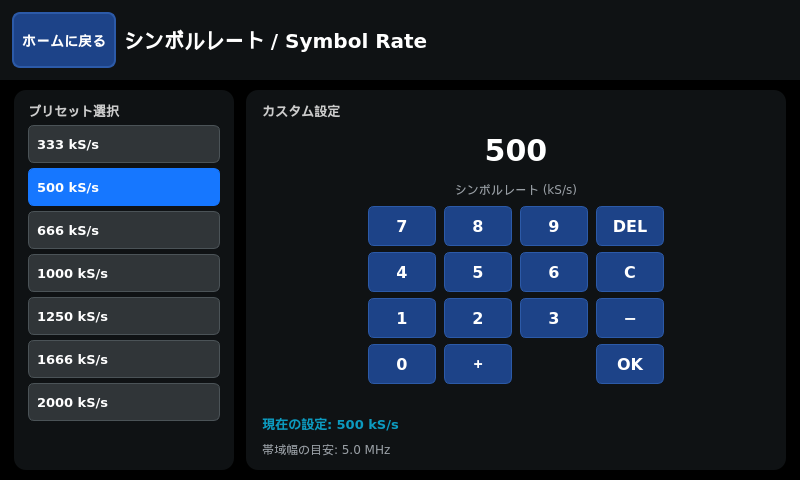 | **シンボルレート / Symbol rate**<br>333〜2000 kS/s のプリセットかテンキーで入力。帯域幅の目安も表示する。<br><br>Pick a preset from 333 to 2000 kS/s or type one; the approximate bandwidth is shown. |
| 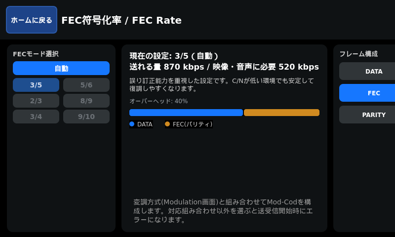 | **誤り訂正 / FEC**<br>自動、または変調方式ごとに使える符号化率から選ぶ。送れるビットレートと映像・音声に必要なビットレートを比べて表示する。<br><br>Auto, or a code rate valid for the modulation. Shows the payload rate against the rate needed for video and audio. |
| 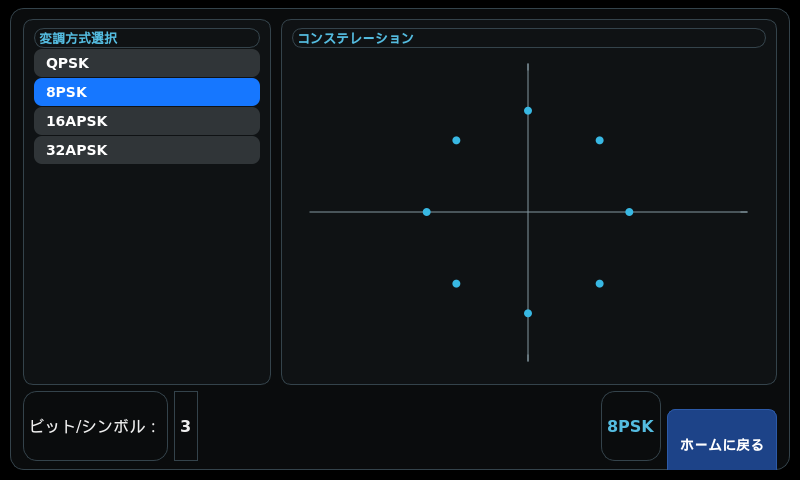 | **変調方式 / Modulation**<br>QPSK・8PSK・16APSK・32APSK とコンステレーション。16APSK・32APSK は Pluto+ の FPGA 版ファームのときだけ選べる(下の注意)。<br><br>QPSK, 8PSK, 16APSK, 32APSK with the constellation. 16APSK/32APSK only with the Pluto+ FPGA firmware (see the note below). |
| 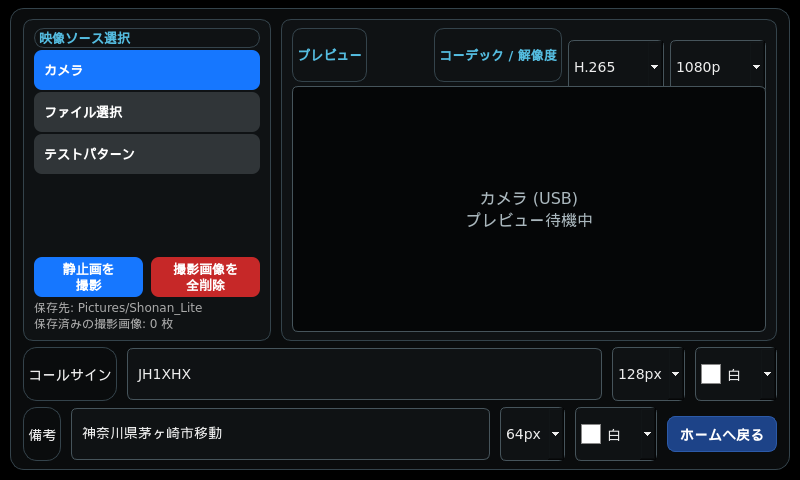 | **映像ソース / Video source**<br>カメラ・画像ファイル・テストパターンから選ぶ。コーデック(H.264/H.265)と解像度、コールサイン・備考の焼き込みも設定する。カメラでは静止画を撮れる。<br><br>Camera, image file or test pattern; codec (H.264/H.265), resolution and the burned-in callsign/note. Stills can be captured from the camera. |
| 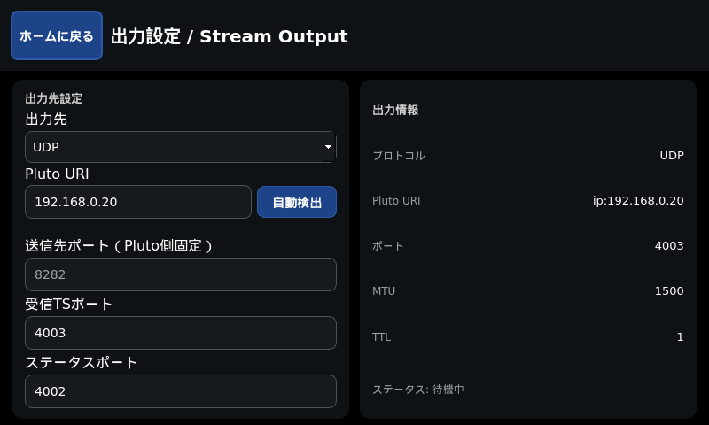 | **出力設定 / Stream output**<br>Pluto の IP(自動検出あり)と受信 TS・ステータスのポート。送信先のポートは Pluto 側で 8282 に固定。<br><br>Pluto IP (with auto-detect) and the RX TS / status ports. The TX port is fixed at 8282 on the Pluto. |
| 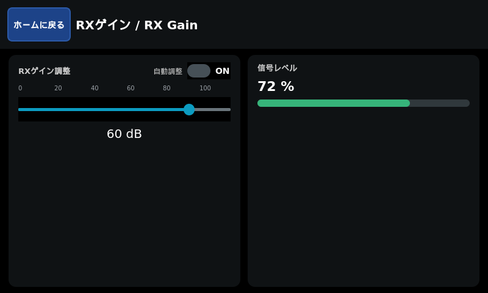 | **RXゲイン / RX gain**<br>受信ゲイン(自動調整 ON/OFF)と信号レベル。<br><br>RX gain (auto on/off) and the signal level. |
| 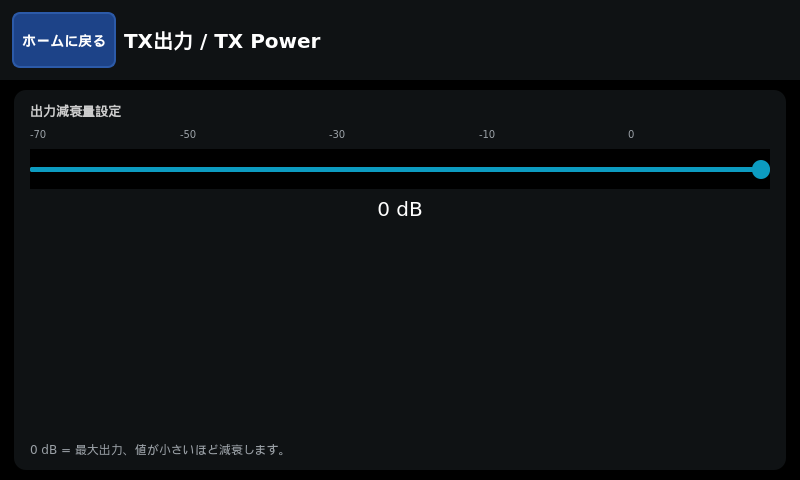 | **TX出力 / TX power**<br>送信出力の減衰量(0 dB が最大)。<br><br>TX attenuation (0 dB is maximum). |
| 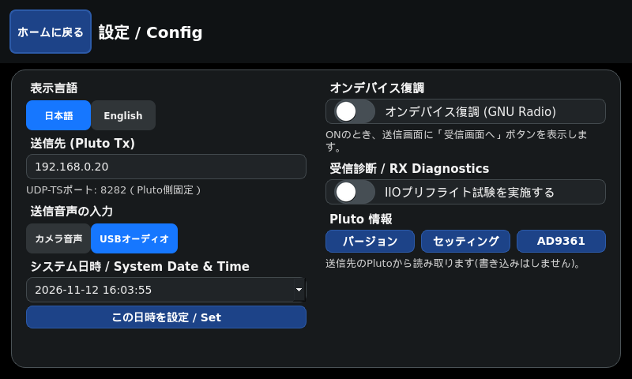 | **設定 / Config**<br>表示言語、送信先の Pluto、送信音声の入力、日時、オンデバイス復調、Pluto 情報(版・settings.txt・AD9361 の値を読むだけ)。<br><br>Language, destination Pluto, TX audio input, date/time, on-device demodulation, and Pluto Info (read-only: version, settings.txt, AD9361 values). |
| 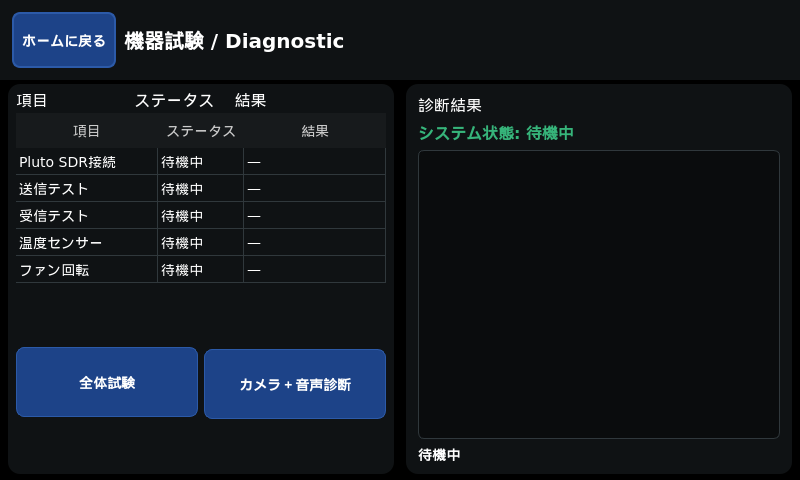 | **機器試験 / Diagnostic**<br>Pluto 接続・送信・受信・温度・ファンをまとめて試す「全体試験」と、カメラ+音声の診断。<br><br>"Full test" of Pluto link, TX, RX, temperature and fan, plus a camera + audio check. |
| 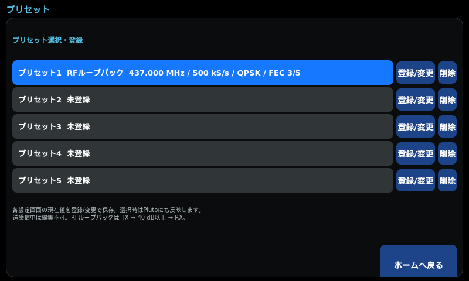 | **プリセット / Presets**<br>今の設定を5件まで登録・呼び出し。プリセット1は未登録の間 RF ループバック試験用。<br><br>Save/recall up to 5 settings. Preset 1 is the RF loopback test while empty. |
| 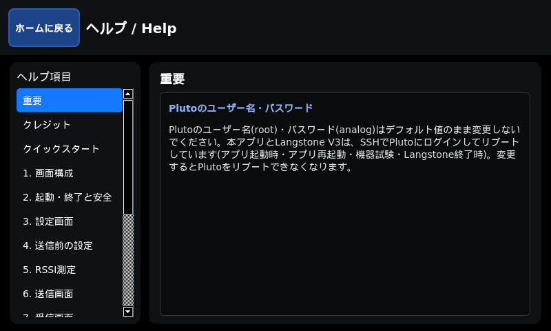 | **ヘルプ / Help**<br>アプリ内の操作説明(目次と検索つき)。操作説明書(docx)と同じ内容。<br><br>In-app manual with contents and search; same content as the operation manual (docx). |
| 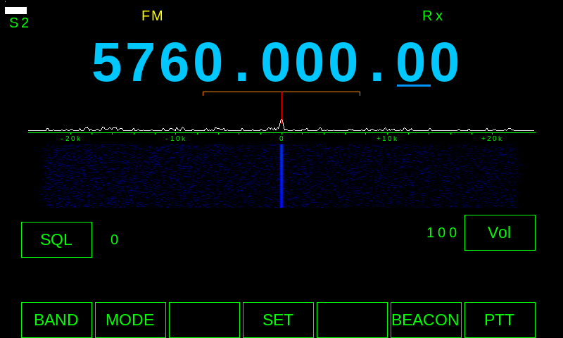 | **Langstone V3**<br>Home の「Langstone」で切り替える SDR トランシーバー(写真は 5760 MHz FM 受信)。「GOTO SHONAN_LITE」で戻る。<br><br>SDR transceiver opened from "Langstone" on Home (shown receiving 5760 MHz FM). "GOTO SHONAN_LITE" returns. |

## インストール / Installation

### 用意するもの / What you need

- Raspberry Pi 5 と起動用の microSD カードまたは NVMe SSD / A Raspberry Pi 5 with a microSD card or NVMe SSD
- **Raspberry Pi OS (64-bit)**(32-bit 版は不可) / **Raspberry Pi OS (64-bit)** (32-bit is not supported)
- Pi 5 と同じ LAN につないだ Pluto(DATV ファーム。インストール中はつながっていなくてよい)
  / A Pluto (DATV firmware) on the same LAN as the Pi 5 (it need not be connected while installing)
- インターネット接続(apt とビルドで使う) / Internet access (for apt and the builds)
- 任意: USB カメラ・USB オーディオ(無くてもテストパターンで動作を確かめられる) / Optional: USB camera and audio (the test pattern works without them)

### 1. Raspberry Pi OS を入れる / Install Raspberry Pi OS

1. PC の [Raspberry Pi Imager](https://www.raspberrypi.com/software/) で、デバイス **Raspberry Pi 5**・OS **Raspberry Pi OS (64-bit)** を選ぶ。
   / In [Raspberry Pi Imager](https://www.raspberrypi.com/software/) on a PC, choose **Raspberry Pi 5** and **Raspberry Pi OS (64-bit)**.
2. 詳細設定(歯車)でホスト名・ユーザー名(例 `pi`)・パスワード・Wi-Fi・**SSH 有効**を設定して書き込み、Pi 5 を起動する。
   / In the advanced options set the hostname, user (e.g. `pi`), password, Wi-Fi and **enable SSH**; write and boot the Pi 5.
3. PC から `ssh pi@<Pi 5 の IP>` で入れることを確かめる。 / Check that `ssh pi@<Pi 5 IP>` works from the PC.

### 2. Pluto の LAN の IP を決める / Set the Pluto LAN IP

Pluto を PC に USB でつなぎ、出てきたドライブの `config.txt` の `[USB_ETHERNET]` に Pi 5 と同じネットワークの IP を書いて、ドライブを取り出す(保存されて Pluto が再起動する)。
/ Connect the Pluto to a PC by USB, set an IP on the Pi 5's network in `[USB_ETHERNET]` of `config.txt` on its drive, and eject (it saves and reboots).

```ini
[USB_ETHERNET]
ipaddr_eth = 192.168.0.20
netmask_eth = 255.255.255.0
```

詳細 / Details: [`pi5/docs/pluto_network.md`](pi5/docs/pluto_network.md)

### 3. アプリを入れる / Install the app

次のどれか 1 つで入れます。 / Use one of the following.

**A. Pi 5 で GitHub から取る(基本) / On the Pi 5 from GitHub (standard)** — Pi 5 に SSH で入って / log in to the Pi 5 by SSH

```sh
sudo apt-get update && sudo apt-get install -y git   # git が無いとき(初回のみ) / if git is missing (first time)
git clone https://github.com/kazushinjo/Shonan-V2_Lite-RasPI5.git
cd Shonan-V2_Lite-RasPI5
./pi5/scripts/install.sh
```

このリポジトリは公開なので、GitHub の認証は要りません。SSH 鍵で取りたいときは `install.sh` の代わりに `install_ssh.sh`。
/ The repository is public, so no GitHub authentication is needed. To fetch with an SSH key, use `install_ssh.sh` instead.

**B. PC から送って入れる / From a PC** — Mac・Linux・Windows(Git Bash)

```sh
git clone https://github.com/kazushinjo/Shonan-V2_Lite-RasPI5.git
cd Shonan-V2_Lite-RasPI5
./pi5/scripts/deploy_to_pi5.sh        # Pi 5 の IP とユーザー名を聞かれる / asks for the Pi 5 IP and user
```

PC の中身(`.git` 以外)を Pi 5 の `~/shonan-pi5-src` に送り、Pi 5 上で `install_local.sh` を実行します。
SSH のパスワードは最初の 1 回だけ聞かれます(`sudo` のパスワードも途中で聞かれることがあります)。
/ Sends the clone (without `.git`) to `~/shonan-pi5-src` on the Pi 5 and runs `install_local.sh` there. The SSH password is asked only once (`sudo` may ask too).

**C. Pi 5 にあるクローンから入れる / From a clone already on the Pi 5** — Pi 5 が GitHub に届かない場所など / e.g. when the Pi 5 cannot reach GitHub

```sh
./pi5/scripts/install_local.sh
```

**時間のかかる部分を省く / Skipping the long builds** — 省いた機能は使えなくなります / the skipped feature is then unavailable.
A〜C のどれでも、前に付けて指定できます(例 `SKIP_JA_KEYBOARD=1 ./pi5/scripts/install.sh`)。

| 変数 / Variable | 省くもの / Skips |
| --- | --- |
| `SKIP_JA_KEYBOARD=1` | 日本語キーボードのビルド(10〜20分) / Japanese keyboard build (10–20 min) |
| `SKIP_GNURADIO_BUILD=1` | 受信用 GNU Radio・gr-dvbs2rx(**受信できなくなる**) / RX GNU Radio and gr-dvbs2rx (**no reception**) |
| `SKIP_LANGSTONE_BUILD=1` | Langstone V3 |

インストール先は `~/shonan-pi5`(`SHONAN_INSTALL_DIR` で変更可)。インストールは次の順に進み、どこかで失敗するとそこで止まります。
/ Installs to `~/shonan-pi5` (`SHONAN_INSTALL_DIR`). It runs these steps and stops at the first failure.

0. 前提の確認(git・SSH 鍵) / prerequisites → 1. ソース取得 / source → 2. apt パッケージ / packages →
3. 日本語キーボード / Japanese keyboard → 4. GNU Radio・gr-dvbs2rx(APSK パッチを含む / with the APSK patch) →
5. Langstone V3 → 6. 起動時の表示を抑える / quiet boot → 7. 再起動・切替の sudo 許可 / sudoers →
8. 電源電圧警告アイコンを消す / no under-voltage icon → 9. systemd サービス登録 / services → 最後に入ったものを確かめる / final check

途中で電源やネットワークが切れない状態で実行してください。 / Run it where power and network will not be interrupted.

### 4. 起動と初期設定 / First start

1. Pi 5 を再起動すると、Shonan_Lite と Langstone V3 を選ぶメニューが出る。Shonan_Lite を選ぶ。
   / Reboot the Pi 5; a menu offers Shonan_Lite or Langstone V3. Choose Shonan_Lite.
2. 「設定」→「送信先 (Pluto Tx)」に手順 2 の Pluto の IP を入れる(「出力設定」の「自動検出」でも探せる)。
   / Enter the Pluto IP from step 2 under Config → "Destination (Pluto Tx)" (or use "Auto detect" on Stream Output).
3. 「設定」→「Pluto 情報」→「バージョン」で Pluto が読めれば接続できている。 / If Config → Pluto Info → Version reads the Pluto, it is connected.
4. 使い方はホームの「ヘルプ」へ。 / See "Help" on the Home screen for how to use it.

### 更新 / Updating

入れたときと同じ方法をもう一度実行します(A なら Pi 5 で `./pi5/scripts/install.sh`、B なら PC で `git pull` してから `deploy_to_pi5.sh`)。設定(`~/.config/shonan-pi5/settings.json`)は残ります。
/ Run the same method again (A: `./pi5/scripts/install.sh` on the Pi 5; B: `git pull` on the PC, then `deploy_to_pi5.sh`). Settings (`~/.config/shonan-pi5/settings.json`) are kept.

手順の詳しい説明とトラブル: [`pi5/docs/install_script_guide.md`](pi5/docs/install_script_guide.md)(英語 [`install_script_guide_en.md`](pi5/docs/install_script_guide_en.md))。
/ Detailed steps and troubleshooting: see the install script guide.

## Langstone V3 と 10GHz 受信 / Langstone V3 and 10 GHz reception

- Home の「Langstone」で [g4eml/Langstone-V3](https://github.com/g4eml/Langstone-V3) に切り替え、Langstone の「GOTO SHONAN_LITE」で戻る。Pi 5・Pluto とも再起動しない。
  / "Langstone" on Home switches to Langstone V3; "GOTO SHONAN_LITE" returns. Neither the Pi 5 nor the Pluto reboots.
- Home の衛星をタップすると、10236.5 MHz 表示・Pluto 受信 486.5 MHz(LNB 局発 9750 MHz)の**受信専用**バンドで開く。LNB の電源は別に用意する。
  / The satellite opens a **receive-only** band (10236.5 MHz shown, Pluto RX 486.5 MHz, LNB LO 9750 MHz). Power the LNB separately.
- 改造点・内部の仕組み・本家の取り込み方: [`pi5/docs/langstone_v3_notes.md`](pi5/docs/langstone_v3_notes.md)。 / Modifications, internals and upstream updates: see that file.

## PA/LNA の送受信切替 / PA/LNA switching

Pi 5 の GPIO21(40番ピン、GND 39番)が送信中 HIGH(3.3 V)。Shonan_Lite と Langstone V3 の両方で同じピン。電流は取れないのでトランジスタ等で受けて PA・LNA を切り替える。
/ GPIO21 (pin 40, GND pin 39) is HIGH (3.3 V) while transmitting, for both apps. Buffer it (transistor, relay driver) before driving the PA/LNA.

## 関連ドキュメント / Documents

- [`pi5/docs/shonan_pi5_operation_manual.docx`](pi5/docs/shonan_pi5_operation_manual.docx) — 操作説明書 / Operation manual(`pi5/docs/build_operation_manual.py` で [`pi5/gui/manual_content.py`](pi5/gui/manual_content.py) から作る / generated from the in-app help content)
- [`pi5/docs/install_script_guide.md`](pi5/docs/install_script_guide.md) — インストールの詳細 / Installation in detail
- [`pi5/docs/pluto_network.md`](pi5/docs/pluto_network.md) — Pluto の LAN 設定 / Pluto network settings
- [`pi5/docs/langstone_v3_notes.md`](pi5/docs/langstone_v3_notes.md) — Langstone V3・10GHz 受信の詳細 / Langstone V3 and 10 GHz details
- [`pi5/docs/screen_capture.md`](pi5/docs/screen_capture.md) — 画面の撮り方 / Capturing the screen
- [`pi5/docs/apsk_simulation.md`](pi5/docs/apsk_simulation.md) — APSK 受信のシミュレーション結果 / APSK RX simulation
- [`pi5/docs/qtvirtualkeyboard_ja_build.md`](pi5/docs/qtvirtualkeyboard_ja_build.md) — 日本語キーボードのビルド / Japanese keyboard build

## 免責事項 / Disclaimer

1. **無保証・自己責任 / No warranty; use at your own risk**  
   本ソフトウェアは現状のまま(AS IS)で提供され、動作、品質、特定の目的への適合性を含め、いかなる保証もありません。本ソフトウェアの使用または使用できないことによって生じた、機器の破損、データの消失、電波障害、その他一切の損害について、開発者は責任を負いません。ご自身の責任においてご利用ください。  
   This software is provided "AS IS" without warranty of any kind, including any warranty of operation, quality or fitness for a particular purpose. The developers accept no liability for any damage arising from the use of, or inability to use, this software, including damage to equipment, loss of data and radio interference. Use it at your own risk.
2. **免許と法令の順守 / Licensing and compliance with the law**  
   本ソフトウェアは、アマチュア無線のDATV(デジタルATV)実験のための送受信ソフトウェアです。電波を送信するには、運用する国・地域の法令に基づく免許が必要です(日本国内ではアマチュア局の免許)。周波数、空中線電力、電波の型式、運用できる範囲などの法令(日本国内では電波法および関係規則)を守ってください。免許のない送信や、免許の範囲を超えた送信は、法令違反となることがあります。本ソフトウェアは、設定された周波数・出力・変調方式が法令に適合していることを確認も保証もしません。送信の内容と結果は、すべて使用者の責任です。  
   This software is for amateur-radio DATV (digital ATV) experiments. Transmitting requires a license under the laws of the country or region where you operate (in Japan, an amateur station license). Observe the applicable laws on frequency, transmitter power, emission type and permitted operation (in Japan, the Radio Act and related regulations). Transmitting without a license, or beyond the scope of your license, may violate the law. This software neither checks nor guarantees that the configured frequency, power and modulation comply with the law. You are solely responsible for what you transmit and for the results.
3. **機器の取り扱い / Handling of equipment**  
   PlutoのTXとRXの接続、外部アンプ(PA)・アッテネータ・アンテナの接続、送信出力の設定、GPIO21の配線を誤ると、機器を破損したり、他の無線局へ障害を与えたりするおそれがあります。機器の仕様を確認し、使用者の責任で行ってください。特に、TXをRXへ直接接続せず、40 dB以上の減衰器を介してください。  
   Wrong connections between the Pluto's TX and RX, wrong external amplifier (PA), attenuator or antenna connections, wrong transmit power settings, or wrong wiring of GPIO21 may damage equipment or interfere with other stations. Check the specifications of your equipment and do this at your own responsibility. In particular, never connect TX directly to RX; use an attenuator of 40 dB or more.
4. **第三者ソフトウェアとライセンス / Third-party software and license**  
   本ソフトウェアは、GNU Radio、gr-dvbs2rx、libiio、FFmpeg、Qt(PyQt5・Qt Virtual Keyboard)、Langstone V3などの第三者ソフトウェアを利用・同梱します。それぞれのライセンスに従います。本ソフトウェア自体は GNU General Public License v3.0(GPLv3)の下で提供されます(下記「License」参照)。  
   This software uses and bundles third-party software such as GNU Radio, gr-dvbs2rx, libiio, FFmpeg, Qt (PyQt5, Qt Virtual Keyboard) and Langstone V3, each under its own license. This software itself is provided under the GNU General Public License v3.0 (GPLv3); see "License" below.
5. **動作について / About behavior**  
   ご使用のRaspberry Pi・環境によって動作が異なる場合や、未発見の不具合が含まれる可能性があります。  
   Behavior may differ depending on your Raspberry Pi and environment, and undiscovered defects may remain.

## クレジット / Credits

- 受信部の方式考案・受信部原システム設計: 山崎慎慈氏(JE1BTA)
  rpi-dvbs2-receiver-guiの設計に基づきます
- 受信部安定化調査修正・再捕捉修正・本アプリ開発: 真城和一
- 本アプリは、Dave Crump氏(G8GKQ)が開発したDATV送受信機プロジェクト「Portsdown」に啓発され、開発したものです。同氏の先駆的な取り組みに感謝いたします。
- Langstone V3(SDRトランシーバー): [g4eml/Langstone-V3](https://github.com/g4eml/Langstone-V3)
  (オリジナルから一部変更しています。差分は
  [`pi5/docs/patches/langstone_v3_shonan_lite.patch`](pi5/docs/patches/langstone_v3_shonan_lite.patch)を参照)

<!-- English -->

- Reception method and original reception system design: Shinji Yamazaki (JE1BTA),
  based on the design of rpi-dvbs2-receiver-gui
- Reception stability investigation and fixes, re-acquisition fixes, and development of this app: Kazuichi Shinjo
- This application was developed inspired by "Portsdown", the DATV transceiver project created by Dave Crump (G8GKQ). We extend our deep gratitude for his pioneering work.
- Langstone V3 (SDR transceiver): [g4eml/Langstone-V3](https://github.com/g4eml/Langstone-V3)
  (partially modified from the original; see
  [`pi5/docs/patches/langstone_v3_shonan_lite.patch`](pi5/docs/patches/langstone_v3_shonan_lite.patch) for the diff)

## License

本ソフトウェアはGNU General Public License v3.0(GPLv3)の下で提供されます。
ライセンス全文: [LICENSE](LICENSE)

This software is licensed under the GNU General Public License v3.0 (GPLv3).
Full license text: [LICENSE](LICENSE)

- Langstone V3 (SDR transceiver, [g4eml/Langstone-V3](https://github.com/g4eml/Langstone-V3)): GPLv3
- Reception subsystem design (Shinji Yamazaki, JE1BTA): GPLv3
- Application development, reception stability fixes (Kazuichi Shinjo): GPLv3
